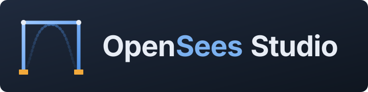
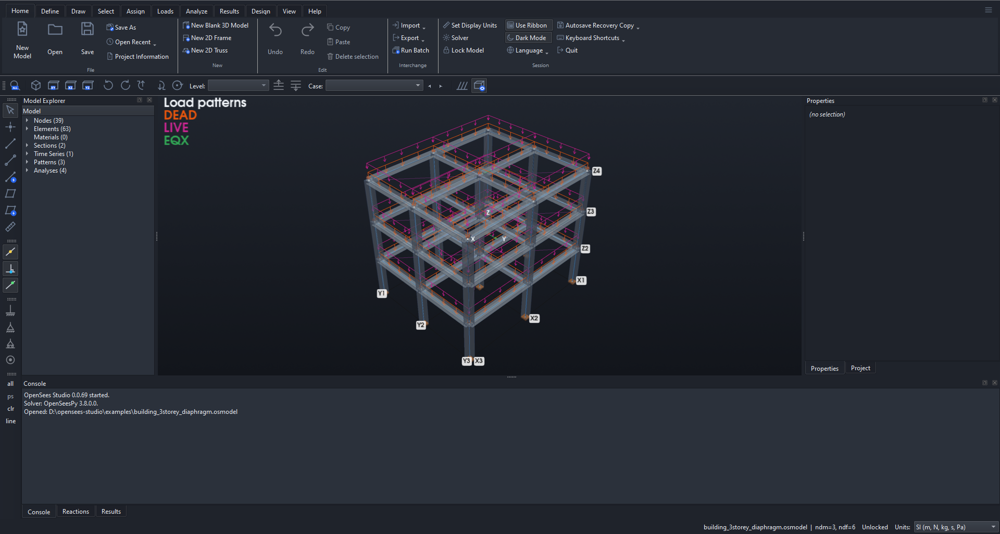

<p align="center">
  
</p>

<p align="center">
  <a href="https://openseespydoc.readthedocs.io/">OpenSeesPy</a> için
  modern bir masaüstü arayüzü —
  OpenSees ekosisteminden ayrılmadan görsel bir modelleme ortamı isteyen
  yapı ve deprem mühendisleri için.
</p>

<p align="center">
  <em>Durum: pre-alfa. Aktif geliştirme sürüyor. API'ler ve dosya biçimi değişecek.</em>
</p>

<p align="center">
  <a href="README.md">English</a> · <a href="README.es.md">Español</a> ·
  <strong>Türkçe</strong> ·
  <a href="docs/tutorials/README.md">Öğreticiler</a> ·
  <a href="docs/verification-manual.md">Doğrulama Kılavuzu</a>
</p>

---



> Bu, Türkçe bir özettir. Her işlevi, menü seçeneğini ve biçim ayrıntısını
> listeleyen eksiksiz başvuru kaynağı [İngilizce README](README.md)'dir.
> Uygulamanın arayüzü İngilizce ve İspanyolcadır; menü adları burada
> uygulamadaki gibi İngilizce yazılmıştır.

## Neden

OpenSees, deprem mühendisliğinde doğrusal olmayan sonlu elemanlar çözücüsünün
referans adıdır, ama kendi arayüzü Tcl/Python betikleridir. OpenSees Studio
ona görsel bir arayüz ekler:

- Düğümleri, çubukları, mesnetleri ve yükleri yakalamalı (snap) bir aks
  sistemi üzerinde tıklayarak çizin; Draw Shell (F8), köşelerinden dörtgen ya
  da üçgen bir kabuk oluşturur.
- Çubuklar üzerinde OSNAP: orta nokta, dik iz düşüm ve en yakın nokta; soldaki
  simge çubuğundan açılır ve renkli bir işaretçiyle gösterilir.
- Yayılı, tekil ve yamuk yükleri **global X/Y/Z** olarak girin; her çubuk
  bunları kendi yerel eksenlerine çevirir. **Local axes** kutusuyla wx/wy/wz
  doğrudan da girilebilir.
- Model ve ekran için on bir tutarlı birim sistemi: N ya da kN ile SI (m, mm),
  kgf (m, cm) ve tonf (m) ile metrik, kip ya da lb ile US (in, ft).
- Her yeni proje bilinen malzemelerle başlar: A36, A572 Gr. 50 (varsayılan),
  A992, A500 Gr. B, soğuk şekillendirme için A653 Gr. 33/50 sac, 3000 ve
  4000 psi beton ve harçla doldurulmuş blok yığma (eski projeler için Define →
  Add Default Materials).
- Elastik kesitler bir malzemeyle tanımlanır (varsayılan A572 Gr. 50): E, G ve
  birim hacim ağırlığı ondan gelir ve malzeme değişince onu izler. As2 ve As3
  zorunludur (0 = kesmede rijit).
- AISI soğuk şekillendirilmiş profiller (Section Library → Add Cold-Formed):
  aşık C ve Z profilleri, dudaksız U profiller, şapka profiller ve köşebentler;
  brüt özellikleri AISI doğrusal yöntemiyle (A, Ix, Iy, Ixy, J, Cw, kesme
  merkezi).
- View → Show Local Axes, her çubuğun orta noktasının yanına analizde
  kullanılan eksenlerle aynı kırmızı/yeşil/mavi x/y/z üçlüsünü çizer.
- Bir analizin sonuçları varken model kendiliğinden kilitlenir (durum
  çubuğundaki kilit, Options → Lock Model): bir düzenleme, sonuçları atmadan
  önce sorar.
- Bir düğüme ya da çubuğa sağ tıklayın → Object Information: konumu, atamaları
  ve tüm yükleri, üç sekmede.
- Display → Show Load Assigns, bir yük desenini ya da hepsini çizer: her biri
  kendi rengi ve açıklamasıyla, biri ötekini örtmeyecek şekilde üst üste.
  Düğüm yükleri, çubuk ve kabuklardaki tekil ve yayılı yükler türe göre,
  değerleriyle (`10 kN/m`, `50 kN`) ve büyüklükle orantılı oklarla
  gösterilebilir.
- İki düğüm arasındaki mesafeyi ölçün (Tools → Measure Distance, F7); değer
  panoya kopyalanır.
- Malzemeleri, kesitleri ve yük desenlerini diyaloglardan atayın.
- Statik, modal, itme (pushover), davranış spektrumu ve zaman tanım alanında
  analizleri ilerleme göstergesi ve iptal olanağıyla çalıştırın (her analiz
  ayrı bir süreçte çalışır).
- Sonuçları görün: şekil değiştirmiş durum, modlar, iç kuvvet diyagramları,
  itme eğrileri, zaman geçmişleri, histerezis çevrimleri, kat tabloları.
- Ekranda bir kuvvet diyagramı ya da şekil değiştirmiş durum varken bir
  elemana sağ tıklamak; eksenel kuvvet, V2/V3 kesme, burulma, M2/M3 moment,
  mutlak/göreli şekil değiştirme ve uygulanan yük diyagramlarını 3 x 3 bir
  ızgarada açar. En büyük değerler etiketlidir; sonuç ve birim seçicileri ile
  herhangi bir kesitteki değeri veren bir mesafe imleci de vardır.
- Çok sayıda dosyayı toplu çalıştırın (**File → Run Batch…** ya da
  `python -m opensees_studio.batch klasor/ --jobs 4`): her proje sonuçlarını
  yanına kaydeder ve sonradan açıldığında yeniden hesaplamadan görülebilir.
  Bir `batch_summary.json` / `.csv` özeti yazılır. Etkin özel OpenSees komut
  blokları içeren bir proje, *Run custom Python blocks* işaretlenmedikçe (ya
  da `--allow-custom-commands` verilmedikçe) atlanır: o Python kodu bu
  bilgisayarda çalışır.
- Modeli, birebir aynı yeniden yüklenen tek bir `.osmodel` JSON dosyasında
  saklayın (Git'te karşılaştırılabilir, Python'dan programlanabilir).

Arayüzün arkasındaki aynı `core` modeli (Pydantic), bir betikten ya da Jupyter
defterinden eksiksiz kullanılabilir: arayüz onu kullanmanın bir yoludur, tek
yolu değil.

## Bugün neler çalışıyor (özet)

- **Modelleme**: kartezyen ve silindirik akslar, düğümler, ek kütleler ve
  mesnet yayları, çerçeveler (elastik, kuvvet tabanlı ve yer değiştirme
  tabanlı), kafes çubukları, dörtgen elemanlar, kabuklar (`ShellMITC4`, düzlem
  içi dönme rijitliği olan `ShellDKGQ`, geometrik olarak doğrusal olmayan
  `ShellNLDKGQ` ve `ShellDKGT`/`ShellNLDKGT` üçgenleri; Assign → Area → Shell
  Formulation aralarında geçiş yapar), sıfır uzunluklu elemanlar, kısıtlar,
  equalDOF, rijit diyaframlar, rijit bağlantılar, sismik izolatörler
  (elastomer ve sürtünmeli), serbestlikler, rijit uç bölgeleri, SAP2000
  tarzında özellik çarpanları ve yerleşim noktaları.
- **Prizmatik olmayan kesitler**: elastik kesitlerden; mutlak ya da göreli
  boylarla ve doğrusal, parabolik ya da kübik değişimle tanımlanan bir kesit.
  Atandığında her eleman elastik parçalara bölünür (en az 12, varsayılan 12).
  Şablon sonradan düzenlenebilir ve oluşturulmuş parçalar güncellenir (parça
  sayıları korunur, bu yüzden bölümlemeyi atamadan önce seçin).
- **Malzemeler ve kesitler**: Steel01/02, Concrete01/02/04, Hysteretic ve
  OpenSees malzeme kütüphanesi; düzenleyicili lifli kesitler; AISC v16 profil
  kütüphanesi; **betonarme kesit sihirbazı** (Define → Concrete Section Wizard:
  dikdörtgen, dairesel, T ya da L; φ ya da # donatı, Mander'e göre sargılı
  çekirdek, `Concrete02` ya da Chang-Mander'in çevrimsel `ConcreteCM` betonu,
  lifli kesit ve ACI'ye göre çatlamış kesit ataletli elastik kesit); **trapez
  sac döşeme sihirbazı** (Define → Steel Deck Slab Wizard: nervür geometrisi,
  sac ve üstteki beton → nervürler doğrultusunda kompozit kesitin, öteki
  doğrultuda üst betonun EA ve EI'sıyla ortotropik bir `LayeredShell` kabuk);
  **depo sihirbazı** (Define → Create Warehouse ya da File → New Model →
  Warehouse: beşik, tek eğimli ya da düz çatılı, tek ya da çok açıklıklı 3B
  çerçeveli hangar; en büyük aralıkla aşıklar ve kuşaklar, çatı ve duvarlarda X
  çaprazlar, eleman türüne göre gruplar, aşıklar üzerine ölü ve hareketli çatı
  yükleri ve RNC-07, NSCM ya da ASCE 7-16 düşey yük kombinasyonları; aşıklar
  mafsallıdır ve çatı kirişini yalnızca stabilite köşebendi olan yerlerde
  tutar; sihirbaz bu yanal desteksiz boyları çelik kontrolü için yazar); her
  yeni 3B projede Draw Shell için hazır, 4000 psi betondan **Slab 20cm**
  döşemesi; **betonarme perdeler** (Assign → Frame → RC Wall: 2B modellerde MVLEM makro
  elemanları); **kesit tasarımcısı** (Define → Section Designer: komutlarla
  çizilen — `rect`, `circle`, `poly`, `ishape`, `tube`, `pipe`, `hole`… — ya da
  bir DXF'ten alınan herhangi bir kesit; özellikleri ve sayısal olarak
  hesaplanan Saint-Venant burulma sabiti ile, elastik ya da lifli kesit
  olarak); bir malzemenin çevrimsel davranışını görmek için Material Tester.
- **Yükler ve analiz**: düğüm, yayılı, yamuk, tekil, yüzey ve döşemeden
  kirişlere aktarılan yük desenleri; öz ağırlık; kütle kaynağı; statik, modal
  (deterministik), itme, davranış spektrumu (CQC/SRSS) ve PEER kayıtları ile
  hedef spektruma ölçeklemeli zaman tanım alanında analiz durumları; yük
  kombinasyonları; çerçevelerde sıcaklık yükleri (düzgün ΔT ve gradyanlar,
  Assign → Frame → Temperature Load); tesir çizgileri ve hareketli yükler (bir
  *InfluenceLine* durumu birim yükü bir eleman zinciri boyunca gezdirir,
  Display → Influence Line bir aracı, ör. HL-93 kamyonunu, iki yönde geçirir);
  aşamalı inşaat (bir *Staged construction* durumu grupları aşama aşama kurar,
  dikmeleri ve kalıpları söker ve her aşamanın yüklerini öncekilerin şekil
  değiştirmiş durumu üzerine uygular; yeni düğümler tasarım konumlarında ya da
  şekil değiştirmiş yapıyı izleyerek kurulur; *time-dependent* seçeneğiyle
  zaman, gün cinsinden beton yaşıdır ve fib Model Code 2010'a göre sünme ve
  rötre hesaba katılır, Define → Concrete Creep & Shrinkage'daki
  `TDConcreteMC10` malzemesiyle); parabolik geometrili, sürtünme, eğrilik ve
  zamana bağlı kayıplı eşdeğer yükler olarak ard germe kabloları (Assign →
  Frame → Tendon); kazıklarda zemin yayları (Assign → Frame → Pile Soil
  Springs: kilde Matlock ve kumda API p-y, t-z ve uç q-z yayları, çap ve zemin
  katmanlarından).
- **Analiz durumlarını yeniden adlandırma**: Analyze → Cases'te bir satır
  yeniden adlandırılabilir (çift tıklama ya da **Rename** / F2) ya da formdaki
  *Name* alanı kullanılabilir. Ad yalnızca bir etikettir: sonuçlar ve
  kombinasyonlar korunur.
- **Karanlık mod**: Options → Dark Mode, tüm arayüze ve 3B görüntüleyiciye
  koyu bir renk paleti uygular; tercih oturumlar arasında hatırlanır.
- **Özelliklerde uygulanan yükler**: bir düğüm ya da çubuk seçildiğinde
  üzerindeki yükler desene ve türe göre listelenir (düğüm, düzgün yayılı,
  yamuk, tekil, yüzey, döşeme, sıcaklık).
- **Şerit menü ve Proje paneli**: Options → Use Ribbon, menüleri modelleme
  akışına göre sıralanmış bir şerit menüye çevirir (Home, Define, Draw,
  Select, Assign, Loads, Analyze, Results, Design, View, Help). Her düğme
  menüdekiyle aynı `QAction`'dır; kısayollar, durum ve diyaloglar değişmez. Her
  grup ana komutlarını büyük, kalanını metinli küçük düğmeler olarak gösterir;
  bir alt menü tek bir açılır düğmedir. Her komutun kendi SVG simgesi vardır
  (`opensees_studio/data/icons`); şeritte, menülerde ve araç çubuklarında
  aynıdır. **Proyecto** paneli ağacı (Árbol), varlık tablosunu (Editar) ve
  yardımı (Ayuda) ekler. Klasik menülere geri dönülebilir ve tercih
  hatırlanır.
- **Arayüz dili**: Options → Language; menüleri, diyalogları, düğmeleri ve
  panelleri, tablo başlıklarını, açılır ipuçlarını, açılır listelerin
  seçeneklerini, model gezginini, durum çubuğunu ve mesajların sabit metnini
  İngilizce ile İspanyolca arasında değiştirir. Yardım sayfaları, konsol,
  OpenSees komut ve parametre adları ve değer içeren mesajlar İngilizce kalır. Türkçe arayüz henüz yoktur.
- **Betonarme tasarım**: Design → Concrete Frame Check, kesiti beton ve donatı
  lifli kesit olan her elemanı (kesit sihirbazınınkiler dahil; analiz onların
  çatlamış elastik eşini kullansa bile) **ACI 318-19**'a göre kontrol eder:
  birim şekil değiştirme uygunluğuyla P-M etkileşimi ve net çekme birim şekil
  değiştirmesine göre φ, iki eksenli eğilme (Bresler), verilen etriyelerle
  kesme, burulma eşiği, en az donatı oranı ve kirişlerde εt ≥ 0.004; oranlar
  model üzerinde renklendirilir.
- **Taban plakaları ve bulonlu birleşimler**: Design → Steel Connections →
  Base Plates, her kolon tabanının plakasını ve ankraj bulonlarını tasarım
  yükleri altında kontrol eder (AISC Design Guide 1, ACI 318-19 bölüm 17):
  merkezi mafsallı tabanlar, momentiyle ankastre tabanlar, kolon türüne göre
  konsol (I profil, HSS, boru) ve plaka kalınlığı boyutlandırması; momentli
  kalkma, ankraj sıraları ve yalnızca basınç alan betonla çözülür. Design →
  Steel Connections → Connections by Joint, her eleman ucunu sınıflandırır
  (kirişten kolon başlığına ya da gövdesine, kirişten ana kirişe, çapraz, ek,
  taban), birleşimi önerir ve basit uçların kesme levhalarını kontrol eder
  (AISC Manual bölüm 10). Design → Connection Calculators → Base Plate &
  Anchors ve Bolted Connection (kaldıraç etkisi ve eksantrik bulon grupları),
  bir mesnet tepkisinden talepleri okuyabilen hesaplayıcılar olarak kalır.
  Design menüsü bir çelik tasarımın sırasını izler: esaslar ve doğrudan
  analiz, elemanlar, kontrol ve sonuçları, ardından birleşimler.
- **Tasarım esasları ve Doğrudan Analiz Yöntemi**: Design → Design Basis
  (AISC); yöntemi (LRFD/ASD), stabilite tasarımını (AISC 360 bölüm C ya da ek
  7), her yönün yatay yük taşıyıcı sistemini ASCE 7 tablo 12.2-1'den R, Ω0 ve
  Cd ile ve her profil ailesinin çeliğini (A36, A572 Gr. 50, A992, A588, A500
  Gr. B/C, A1085, A53; AISC Manual tablo 2-4 değerleriyle) belirler. Design →
  Direct Analysis Method, ASCE 7-16'nın her LRFD kombinasyonunu ikinci mertebe
  bir duruma çevirir: tüm çerçevelerde P-Delta, ×0,8 rijitlik (C2.3, 0,001 α Yi
  ile τb = 1) ve o kombinasyonun katsayılı düşey yüklerinden `0,002 α Yi` fiktif
  yükleri; ardından kat başına Δ2/Δ1'i (C2.2b(d)) raporlar ve çelik kontrolü bu
  durumları K = 1 ile okur. Design → Built-Up Shapes, levhalarından kaynaklı I
  profiller ve levha kirişler tanımlar (kc ile başlık sınırları, F4/F5,
  berkitmeli gövde kesmesi). Design → Member Classification, fiziksel
  elemanları (aynı kesitteki doğrusal elemanlar), rollerini ve yanal destek
  noktalarına göre Lx, Ly ve Lb yanal desteksiz boylarını gösterir; kontrol bu
  boyları kullanır, böylece ağ örülmüş bir eleman gerçek boylarını korur.
- **Tasarım**: Design → Steel Frame Check, W, M, S ve HP profillerinden —ve U
  profiller, T'ler, eşit kollu köşebentler, dikdörtgen ve dairesel HSS'ler ve
  borulardan— oluşan elemanları **AISC 360-16**'ya göre (LRFD ya da ASD) kontrol
  eder: çekme (D2), basınç (E3, E4, E7), eğilme (F2–F10), kesme (G2–G6) ve H1
  etkileşimi; önceden çalıştırılmış kombinasyonlar üzerinde, 25 noktada,
  diyagramdan `Cb` ve eleman bazında K, Lb, Cb, net alan ve gecikme
  ayarlarıyla. İsteğe bağlı bir **P-δ için B1 büyütmesi** (AISC 360-16 C2.1b),
  birinci mertebe bir analizin dışarıda bıraktığı eğriliği karşılar. Bir
  **sismik sistem** (AISC 341-22); `Ry` ve `Ca` ile Tablo D1.1 narinlik
  kontrolünü, SMF düğümlerini (E3.4a, panel bölgesi J10.6 ve süreklilik
  levhaları E3.6f), F2.3 kapasite tasarımını ve SCBF F2.5b sınırlarını ve OCBF
  F1.4/F1.5/F1.6 kapsamını ekler. Ayrı diyaloglar **AISC 358-22 RBS
  birleşimlerini** (5.7 ve gövde birleşimi 5.5), **SCBF bayrak levhalarını**
  (Whitmore, akma, burkulma, F2.6c talepleri ve kaynak), **SCBF kolon eklerini**
  (F2.6d) ve **AISC 360 Bölüm J birleşim kontrollerini** (J2–J10) düzenler.
  Assign → Frame → Local Axes, bir 3B elemanın kesitini kendi ekseni etrafında
  döndürür; IFC dışa ve içe aktarımı bu dönüşü korur. Design → Display Steel
  Ratios her elemanı oranına göre renklendirir; Design → Generate Notional
  Loads, AISC 360 C2-1'in `0.002 α Yi` desenini üretir (LRFD'de α = 1,0, ASD'de
  1,6); Design → Storey Drift Check, büyütülmüş kat ötelemelerini ASCE 7,
  NCh433, Eurocode 8, RNC-07 ya da NSCM Managua ile karşılaştırır. Rapor ve hesap raporu; eleman,
  düğüm, birleşim, levha, ek ve Bölüm J kontrollerini yazdırır. Ayarlar
  projeyle birlikte kaydedilir.
- **İçe ve dışa aktarma**: DXF çizimleri,
  [PORTICO](https://github.com/jpreyes/portico-core) modelleri (`.s3d`,
  seçtiğiniz birimlere ölçeklenerek), SAP2000 metin dosyaları (`.s2k` /
  `.$2k`; iki yönde, çubuk bazında özellik çarpanları ve rijit diyaframlar
  dahil, CSI yazılımı olmadan tablo biçiminden yazılır; SAP2000, Computers and
  Structures, Inc.'in markasıdır), OpenSeesPy betikleri, OpenSees Tcl
  dosyaları (`.tcl`, resmî deponun örnekleri dahil; değişkenler, `expr`,
  `foreach`, `if`, `proc`, `source` ve `for` yorumlanır, hiçbir zaman
  çalıştırılmaz), IFC ve HTML/PDF hesap raporu.

Yerel eksen dönüşü S2K dışa aktarımına yazılır; S2K içe aktarımı onu en yakın
kesit yönlendirmesine yaklaştırır (IFC onu tam olarak korur).

**S2K içe aktarımı geliştirilmektedir:** okunan tablolar, yaklaşımlar ve
desteklenmeyenler
[docs/sap2000-import-status.md](docs/sap2000-import-status.md) dosyasındadır.

## Doğrulama

[Doğrulama Kılavuzu](docs/verification-manual.md), OpenSees Studio'yu kapalı
ve yayımlanmış çözümlerle karşılaştırır — Euler-Bernoulli ve Timoshenko
kirişleri, 2B ve 3B, kafes sistemler, mesnet çökmeleri, P-Δ, frekanslar, zaman
tanım alanı, spektrum, bir kabuk plak (`ShellDKGQ`/`ShellDKGT` ile de),
Scordelis-Lo çatısı, kat kat inşa edilen bir kolon, bir kolonun 10 000 günlük
sünme ve rötresi, ucundaki bir momentle çeyrek daire biçiminde bükülen bir
konsol (büyük dönmeler), ACI 318-19'dan bir kiriş ve bir kolon, lifli bir
kesitin plastik momenti ve AISC tasarım örnekleri — her biri bağıl hatası ve
toleransıyla. Kılavuz gerçek analizlerden üretilir
(`tools/verification_manual.py`); bir durum toleransının dışına çıkarsa ya da
dosya güncel değilse sürekli entegrasyon başarısız olur.

**Hiçbir sonuç değişikliği sessizce geçmez.** `examples/` altındaki her
projenin her durumu bir parmak iziyle (serbestlik derecesi başına en büyük yer
değiştirme, tepkilerin toplamı, elemanlardaki en büyük kuvvet, normlar,
periyotlar, adım sayısı) `tests/data/results_snapshots.json` dosyasına
sabitlenir; herhangi biri 1e-5 bağıl değerden fazla değişirse sürekli
entegrasyon başarısız olur. Sayıları bilerek değiştiren bir düzeltme
`python tools/results_snapshot.py --write --reason "..."` ile sabitlenir; bu
komut önceki ve sonraki değerleri
[docs/results-changes.md](docs/results-changes.md) dosyasına kaydeder ve sürüm
notları bunu **Results changed** başlığında duyurur.

## Öğreticiler

Adım adım anlatımlar, İngilizce ve İspanyolca: [docs/tutorials](docs/tutorials/README.md).

1. AISC 360-16'ya göre bir çelik çerçevenin tasarımı.
2. Rijit döşemeli bir bina: modlar, davranış spektrumu ve kat ötelemeleri.
3. Bir PORTICO modelini OpenSees Studio'ya aktarmak.

## Kurulum (Python gerekmez)

Masaüstü paketleri
[releases](https://github.com/ogunc/opensees-studio/releases) sayfasındadır:
sisteminize uygun dosyayı indirin, istediğiniz yere açın ve `OpenSeesStudio`
(ya da `OpenSeesStudio.exe`) dosyasını çalıştırın. Kendi Python, Qt ve VTK'sını
getirir. OpenSees çözücüsünün kendi lisansı vardır ve pakete dahil değildir:
**Options → Solver**'dan bir kez kurun; lisansını kabul ettikten sonra
OpenSeesPy'yi PyPI'dan indirir.

İkinci bir motor ise pakete dahildir: **[PyNite](https://github.com/JWock82/PyNite)**
(MIT lisansı). Elastik çerçeve ve kafes sistemlerin doğrusal statik ve P-Delta
durumlarını hiçbir şey indirmeden çözmek için **Options → Solver → Engine**'den
seçin. Bu modellerde OpenSeesPy ile aynı sonuçları verir; modellemediği şeyleri
(doğrusal olmayan malzemeler, korotasyonel kafes çubukları, kabuklar,
izolatörler, modal ve zaman tanım alanında durumlar…) bir mesajla reddeder, bunlar için OpenSeesPy gerekir.

Yalnızca çalıştırılabilir dosyayı değil, klasörün tamamını açın. İkili
dosyalar imzalı olmadığından sistem ilk seferde engelleyebilir: macOS'te sağ
tık → Aç; Windows'ta "Ek bilgi" → "Yine de çalıştır".

Linux paketi x86-64 üzerinde Ubuntu 22.04 ve sonrası, Linux Mint 21 ve sonrası,
Debian 12 ve LMDE 6'da (glibc 2.35 ya da daha yenisi) çalışır.

Her dosyanın adında sürüm vardır, örneğin
`OpenSeesStudio-0.0.65-windows.zip` ya da `OpenSeesStudio-0.0.65-linux.zip`.

Linux'ta aynı paket tek bir dosya olarak da gelir,
`OpenSeesStudio-<sürüm>-x86_64.AppImage`: açılacak bir şey yoktur, çalıştırılabilir
yapıp açmak yeterlidir.

```bash
chmod +x OpenSeesStudio-*-x86_64.AppImage
./OpenSeesStudio-*-x86_64.AppImage
```

FUSE gerektirir (bu dağıtımlarda varsayılan olarak kurulu gelen `fuse3`
paketinden `fusermount`), ama `libfuse2` gerektirmez. FUSE yoksa
`--appimage-extract-and-run` ile çalıştırın. **Options → Solver**'dan kurulan
OpenSeesPy `~/.local/share/opensees-studio/engines` altına (ya da
`$XDG_DATA_HOME` altına) kaydedilir, bu yüzden AppImage daha yenisiyle
değiştirildiğinde korunur.

## Kurulum (geliştirme)

OpenSees Studio bu depoda geliştirilmektedir; bugünkü kodun büyük kısmı
[marcel1983/opensees-studio](https://github.com/marcel1983/opensees-studio) deposunda yazılıp buraya birleştirildi.
Windows'ta Python 3.12
kullanın: OpenSeesPy 3.8.0.0 tekerleği başka bir sürümde yüklenmez ve uygulama
başka bir sürümde çalışıyorsa Options → Solver bunu belirtir.

```bash
git clone https://github.com/ogunc/opensees-studio.git
cd opensees-studio

python -m venv .venv
.venv\Scripts\activate              # Windows
source .venv/bin/activate           # Linux / macOS

pip install -e ".[gui,dev]"         # arayüz + araçlar + çözücü
```

Modeli arayüz olmadan kullanmak için (betikler, defterler, sunucular):
`pip install -e .` (çözücüsüz) ya da `pip install -e ".[opensees]"` (çözücülü).

**Python 3.12** gereklidir: OpenSeesPy 3.8.0.0 tekerlekleri bunu şart koşar ve
Windows'ta `opensees.pyd`, `python312.dll`'ye bağlıdır.

## Testler

```bash
pytest tests/unit          # saf mantık, milisaniyeler
pytest tests/gui           # Qt olay döngüsüyle testler (pytest-qt)
pytest tests/integration   # gerçek OpenSeesPy analizleri
```

## Performans ve büyük modeller

Programda isteğe bağlı bir performans izleyicisi vardır. `--profile` ile (ya da
`OPENSEES_STUDIO_PERF=1` ile) başlatın ve **Help → Performance monitor**'ü
açın: S2K içe aktarıcısının, proje okuma/yazmanın, analiz sürecinin,
oluşturucunun ve geri alınabilir komutların aşama aşama süreleri; ayrıca
arayüz donmaları ve bir eylemin `cProfile` çıktısı. `--perf-json rapor.json`
aynı raporu çıkışta kaydeder.

Sentetik büyük modellerle tekrarlanabilir ölçümler için:

```bash
python tools/perf_bench.py --size large --profile
python tools/perf_bench.py --size xlarge --solver --cprofile
```

Aşama adları, JSON biçimi ve raporun nasıl okunacağı için
[`docs/performance-profiling.md`](docs/performance-profiling.md) dosyasına
bakın.

## Ekrana göre boyutlanan işaretçiler

Düğümler, mesnetler, yük okları, tepkiler ve kütle işaretçileri modelin bir
kesri olarak değil, görüntü alanı yüksekliğinin yüzdesi olarak boyutlanır.
Yakınlaştırıldığında ekrandaki boyutlarını korurlar ve **Display → Display
Options** her yüzdeyi ayarlamaya izin verir; yazı boyutu piksel cinsinden ayrı
bir değerdir. Bu seçenek açıkken düğüm kütleleri mor eşkenar dörtgenler olarak
çizilir. Boyutlar ve görünürlükler projeyle birlikte taşınır.

Uç serbestlikleri çubuklar üzerinde renkli noktalar olarak çizilir: burulma
için menekşe, M2 için turuncu, M3 için kırmızı ve kısmi ankastrelik için sarı.
**View → Visibility → Releases**, bunları **Frame Assignments**'taki rijit uç
bölgesi çubuklarından bağımsız olarak gösterir ya da gizler.

## Gösterme, gizleme ve yalıtma

**View > Hide Selected** (Ctrl+H) etkin görüntü alanında geçerli seçimi gizler.
**View > Isolate Selected** (Ctrl+Shift+I) yalnızca seçili elemanları ve
düğümlerini ya da yalnızca seçili düğümleri gösterir; bağlam menüsünde de
vardır. **View > Show All Objects** gizlenen her şeyi geri getirir ve aks
çizgisi görünümünü kaldırır. Seçim kutusu o görüntü alanında gizli nesneleri
asla almaz: yalnızca gerçekten çizileni seçer.

## Stabilite kontrolü

**Analyze → Check Model** (ve Run'ın çalıştırmadan önce yaptığı inceleme) her
mekanizmayı ayrı ayrı adlandırır — rijit cisim gibi kayan ya da dönen yapı veya
bir düğüm grubu, serbestçe dönen bir düğüm, aynı doğrultudaki çubuklar, yanal
olarak ötelenen bir çerçeve — ilgili düğüm ve elemanlarla ve ne yapılacağıyla
(hangi mesnet eksik, hangi serbestlik kaldırılmalı, nereye çapraz konmalı).
**Show the motion**, seçilen mekanizmayı model üzerinde canlandırır.

**Analyze → Check Model Stability**, başlangıç rijitliğini OpenSees'in
`PythonSparse`'ı ile seyrek bir CSR matrisi olarak yakalar; küçük bir model
yoğun bir referans, büyük bir model ise köşegen ölçeklemeden sonra kaydırmalı
seyrek bir spektral arama kullanır. Rapor, negatif rijitlik mekanizmalarını ve
kötü koşulluluğu ayırır, kontrolün ne zaman kısmi ya da desteklenmeyen olduğunu
belirtir ve hareket eden düğümleri ve serbestlik derecelerini listeler. Mesnedi
ya da zemine yayı olmayan bağlı bileşenler rijit cisim ötelemesiyle kontrol
edilir ve seyrek özdeğer çözücüsünü beklemeden kısmi mekanizmalar olarak
raporlanır. OpenSees daha büyük bir `nnz` bildirse bile CSR işaretçisinin son
değeri saklanan girdileri belirler ve 32 ya da 64 bitlik tamsayı tamponları
kabul edilir. Alt süreç aşamaları bildirir, Analyze menüsü onu iptal edebilir ve
arayüz 300 s'lik yumuşak bir sınır uygular. Bu bir başlangıç durumu
kontrolüdür; bir burkulma katsayısı ya da doğrusal olmayan bir geçmiş için
garanti değildir. Tekrarlanabilir aileler
`python tools/stability_bench.py --family frame --size 12` (ya da
`--family truss --mechanism`) ile üretilebilir.

## Lisans

AGPL-3.0. Bkz. [LICENSE](LICENSE). OpenSeesPy, kendi lisansı olan ayrı bir
programdır.
